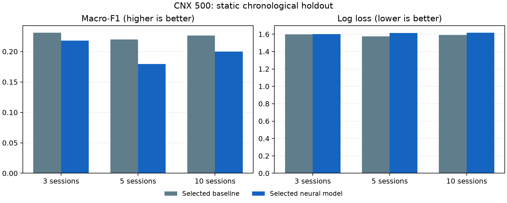
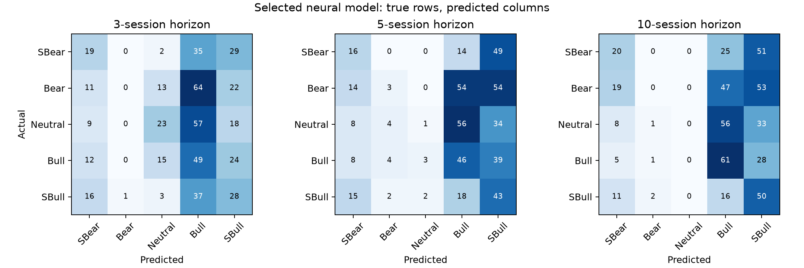

# CNX 500 research results

This is an initial CPU research experiment. Class probabilities are uncalibrated. No trading strategy or profitability claim is evaluated.

## Data and target

The reconciled NSE:CNX500 dataset contains 5,011 daily observations, 2006-07-14 through 2026-10-01. Provider volume is unavailable on 185 observations. OHLC relationships and unique ascending session dates passed checks. Session dates align with official published index history; provider index-volume aggregation semantics remain unverified.

The five ordered labels describe the future endpoint log return divided by trailing 60-session daily volatility and square root of the horizon. Fixed thresholds are -1, -0.25, +0.25 and +1. See EXPERIMENT_SPEC.md for exact boundary inclusion.

Context length counts daily feature rows. Rolling features require up to 60 preceding observations beyond that context. Horizons count observed provider sessions; missing exchange sessions could change their interpretation. All configurations use the same eligible origins and all three labels must be mature.

Full official historical comparison found 11 sessions absent from the original 5,000-row TV snapshot and 14 material shared-date OHLC discrepancies. The canonical dataset adds the 11 official sessions and uses valid official OHLC, correcting 12 discrepant dates. Two official records fail OHLC shape validation and retain the already validated TV values, explicitly flagged. See reports/data_reconciliation.json. Separately, four daily archive spot checks found provider-volume differences, including about 4% on the latest checked date. Session reconciliation is against published index history, not an independent reconstruction of all exchange rules.

## Development comparison

Configuration selection used three expanding historical folds ending before October 2024. Neural epoch counts were selected on purged chronological inner tuning periods and then refit on each permitted training prefix. No final-test model scores were used to select configurations. An initial data audit computed full-history aggregate class counts; thresholds were already fixed and those counts were not used for selection.

| Model / context / features | Mean development macro-F1 | Mean log loss |
|---|---:|---:|
| histboost / 20 days / price | 0.2352 | 1.5869 |
| histboost / 60 days / price | 0.2310 | 1.5983 |
| histboost / 20 days / price + volume | 0.2251 | 1.5918 |
| histboost / 120 days / price | 0.2197 | 1.6033 |
| histboost / 120 days / price + volume | 0.2189 | 1.6028 |
| histboost / 252 days / price | 0.2185 | 1.6214 |
| transformer / 60 days / price | 0.2149 | 1.5739 |
| histboost / 60 days / price + volume | 0.2103 | 1.6073 |
| logistic / 20 days / price | 0.2101 | 1.5973 |
| histboost / 252 days / price + volume | 0.2093 | 1.6204 |
| logistic / 60 days / price | 0.2042 | 1.6524 |
| logistic / 20 days / price + volume | 0.2039 | 1.6197 |

Best configuration within each family (development only):

| Family | Selected context / features | Development macro-F1 |
|---|---|---:|
| majority | 20 / price | 0.0940 |
| logistic | 20 / price | 0.2101 |
| histboost | 20 / price | 0.2352 |
| mlp | 120 / price + volume | 0.1937 |
| transformer | 60 / price | 0.2149 |
| pretrained_transformer | 252 / price | 0.2014 |

The best next-patch-pretrained Transformer scored 0.2014, versus 0.2149 for the best supervised Transformer. This bounded search did not establish a benefit from pretraining.

Selected baseline: **histboost / 20 days / price**.

Selected neural model: **transformer / 60 days / price**.

## Final chronological holdout

Final evaluation covers 487 common prediction origins starting 2024-10-01 and ending 2026-09-17, with fixed model weights throughout. Every fitting target ends before the first test origin. The latest ten origins are excluded from joint scoring because their 10-session labels are not yet available.

| Horizon | Baseline macro-F1 | Neural macro-F1 | Baseline accuracy | Neural accuracy | Baseline log loss | Neural log loss |
|---|---:|---:|---:|---:|---:|---:|
| 3 sessions | 0.2311 | 0.2181 | 24.6% | 24.4% | 1.5967 | 1.6002 |
| 5 sessions | 0.2197 | 0.1795 | 24.2% | 22.4% | 1.5749 | 1.6133 |
| 10 sessions | 0.2262 | 0.1997 | 27.9% | 26.9% | 1.5907 | 1.6179 |

The selected neural model's mean holdout macro-F1 is **0.0266 lower** than the selected baseline. This observed difference is not a statistical significance or profitability claim.

The confusion matrices show substantial class imbalance in the model's predictions: some heads almost never predict Bearish or Neutral. The 10-session head predicted Neutral zero times in this holdout. These are material weaknesses of this initial model; a category such as Strong Bullish describes the target's movement size and must not be read as strong predictive confidence.

## Additional development seed diagnostics

The selected neural configuration was checked with additional initialization seeds using a fixed epoch count selected from the original development run. These diagnostics did not change configuration selection, current weights or final-test fitting. They are not a fresh hyperparameter search and are not directly identical to per-fold early-stopping scores.

| Seed | Mean development macro-F1 |
|---|---:|
| 7 | 0.2014 |
| 2026 | 0.2229 |

## Reproduction and artifact provenance

Dataset SHA-256: `1a377c6466c46646c23d58a7413f8b67cf8e1091c3e8263cc29a57d232f71d57`.

Computational source SHA-256: `b623e041facf5233324f6f6a4f23c06b1521943bcf2bde21f0709ae9bc6d1a48`.

The initial CPU timing benchmark used 1,000 examples, a 60-row price-only context, one pretraining epoch and two supervised epochs: 2.05 seconds. It is a small benchmark, not a full-run runtime guarantee.

Initial neural search used seed 42, 41 total configurations, four CPU threads, up to 20 supervised epochs with patience four, and 4 next-patch pretraining epochs where applicable. Contexts were selected from 20, 60, 120 and 252; no claim of globally optimal context is made. The baseline fixed_epochs field is an unused orchestration budget, not a boosting-iteration count; boosting uses 80 iterations as specified in models.py.

After recording this holdout, separate current research models were refit on all matured history. Current predictions are therefore produced by different weights from those evaluated above. Current predictions, date-level evaluation rows, weights and raw data are local-only artifacts excluded from Git.

## Limitations

One index is a small and dependent dataset. Evaluation windows and targets overlap. Historical market regimes change. Thresholds and model search are research choices. The initial search uses a single seed; subsequent development seed checks are diagnostic only. No economic backtest, execution-cost analysis, prospective paper-trading evidence, formal calibration or confidence intervals have been established. Baseline superiority or weak performance is a valid research outcome.

The aggregate report does not confer rights to redistribute underlying market data or trained weights. Raw source data and date-level derived records stay excluded from publication.
